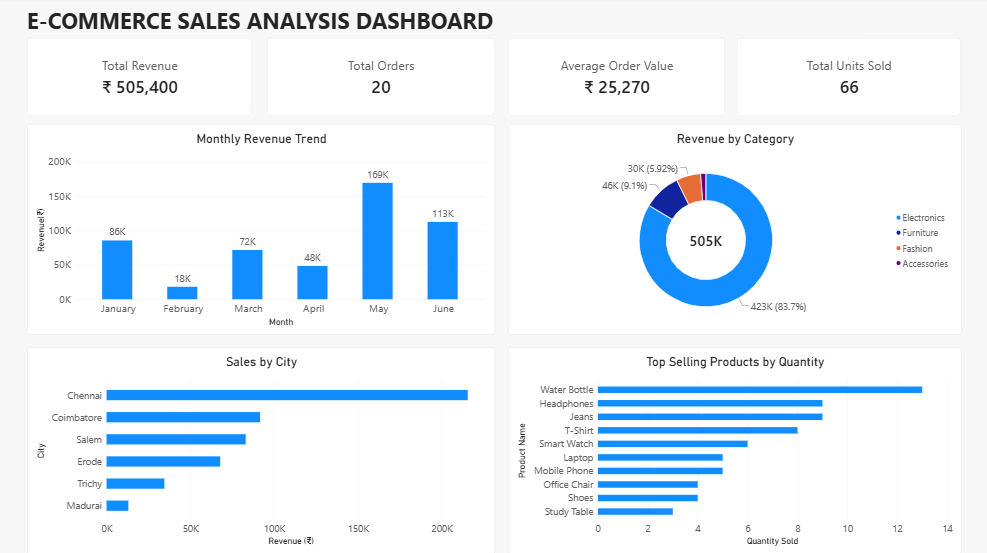

# E-Commerce Sales Analysis | SQL, Excel & Power BI

## Project Overview
This project analyzes e-commerce sales data using SQL, Microsoft Excel, and Power BI to evaluate sales performance, customer purchasing behavior, product performance, and revenue trends.

## Tools & Technologies
- **MySQL** – Data querying, data analysis, joins, aggregations, ranking, and business insights
- **Microsoft Excel** – Data analysis, calculations, summaries, and charts
- **Power BI** – Interactive dashboard and data visualization

## Dataset
The project uses four datasets:

- `customers` – Customer details and city
- `products` – Product names, categories, and prices
- `orders` – Order IDs, customers, and order dates
- `order_items` – Products purchased and quantities

## Project Workflow

### 1. SQL Analysis
Performed sales analysis using MySQL, including:

- Total revenue and order count
- Average order value (AOV)
- Revenue by product category
- Customer spending analysis
- Customers who never placed orders
- Number of orders per customer
- Monthly revenue analysis
- Revenue by city
- Best-selling products by quantity
- Product-wise revenue analysis
- Ranking customers based on total spending
- Total units sold by product category

SQL concepts used:
`JOIN`, `GROUP BY`, `ORDER BY`, `HAVING`, `LEFT JOIN`, subqueries, aggregate functions, `ROW_NUMBER()`, and `LIMIT`.

### 2. Excel Analysis
Used Microsoft Excel for:

- Sales data analysis
- Revenue calculations
- Monthly revenue analysis
- Monthly order analysis
- Category-wise sales analysis
- Product sales analysis
- Charts and visual summaries

### 3. Power BI Dashboard
Created a sales dashboard to visualize key performance indicators and sales trends.

Dashboard highlights:
- Total Revenue
- Total Orders
- Average Order Value
- Total Units Sold
- Monthly Revenue Trend
- Revenue by Category
- Sales by City
- Top Selling Products by Quantity

## Key Business Insights

- **Total Revenue:** ₹5,05,400
- **Total Orders:** 20
- **Average Order Value:** ₹25,270
- **Total Units Sold:** 66
- **Top Revenue-Generating Category:** Electronics – ₹4,23,000
- **Highest Revenue Month:** May – ₹1,69,300
- **Highest Revenue City:** Chennai – ₹2,15,500
- **Best-Selling Product by Quantity:** Water Bottle – 13 units

## Project Structure

```text
Ecommerce_Sales_Analysis_Advanced/
│
├── Excel/
│   └── Ecommerce_Sales_Analysis.xlsx
│
├── Excel_data/
│   ├── customers.csv
│   ├── products.csv
│   ├── orders.csv
│   └── order_items.csv
│
├── PowerBI/
│   ├── Ecommerce_Sales_Analysis.pbix
│   └── Ecommerce_Sales_Dashboard.png
│
└── SQL/
    └── Ecommerce_Sales_Analysis.sql
```

## Dashboard Preview



## Project Objective

To transform raw e-commerce sales data into meaningful business insights through SQL querying, Excel analysis, and interactive Power BI visualizations.

---

**Tools:** MySQL | Microsoft Excel | Power BI

